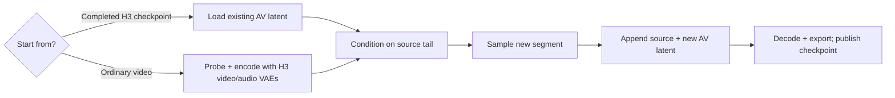
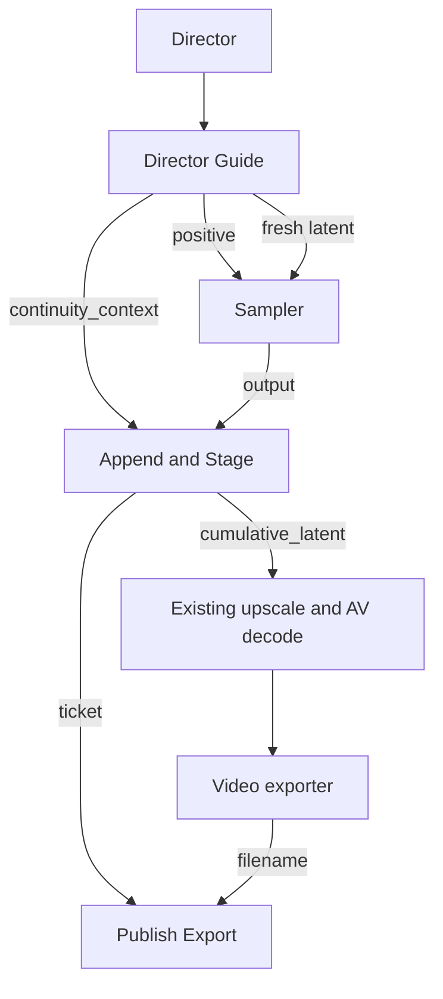
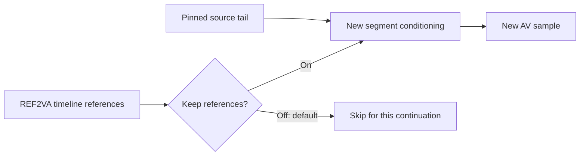
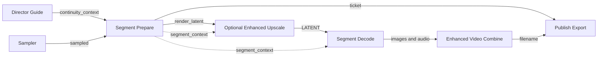
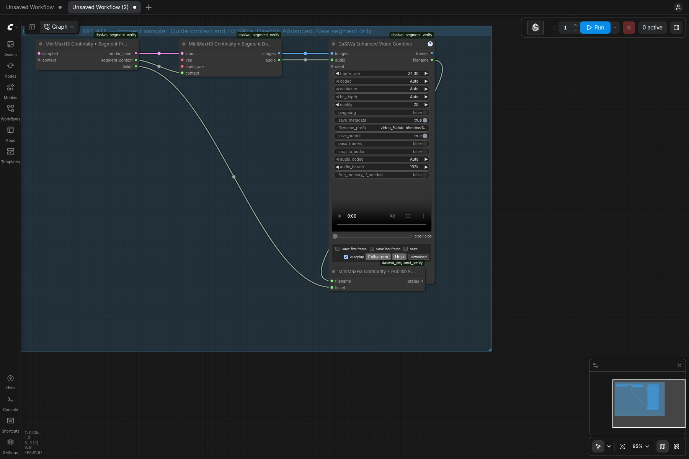

# MiniMaxH3 Director Continuity

The Director owns the controls. Selecting a video or checkpoint automatically shows **Continuity Active**. The actual model mode stays selected; there is no Continue pseudo-mode. The existing **Duration** input controls newly added seconds. Checkpoint capture for new takes is opt-in; saved workflows retain their capture preference.

## Loading older workflows

When loading an older v1/v2 workflow, an active continuation's saved +frames is
converted once to Duration (`frames / 24`). An inactive preselected source stays
inactive. Custom next-action text and the old idea are retained; the former stock
prefill becomes the current automatic policy. Subsequent Duration edits remain
authoritative. In a structured REF2VA prompt, the old idea is inserted into
`detailed_description`, not appended to the final music section. Definitions,
soundscape and empty music remain unchanged. This migration changes workflow
settings, not saved checkpoints.

## Forge next-action priority

With a nonblank next-action idea, Forge treats that idea as the action to write after the seam. It does not send the old full next-action draft as a template. Structured historical prompts contribute only unbound subject definitions: media-bound definitions require the Director's current verified reference mapping and are not restored from source metadata. Removed, disabled, replaced or unverifiable references cause the entire inherited definition (including multiline appearance descriptions) to be omitted, not just its media tag. Surviving references are remapped without renumbering Subject IDs; unbound authored identities remain. Forge displays a notice when definitions are omitted. Source-tail evidence remains valid scene context, so removing a reference does not erase a character already visible in the source video. Plain historical prompts are retained as explicitly historical text only when source-tail images are unavailable and they contain no unverified media citations, including a text-only retry after rejected images. Reference media and RefMods contribute their assigned properties, not a replacement story. Enabled current references are mandatory grounding for the draft even when no historical snapshot or inherited definition exists: Forge is instructed to rebuild their subject grounding from current images and explicit notes. The idea sets the action, not whether those references are used. Saved RefMods without visible images remain cited conditioning sources; Forge must not invent their appearance. The existing reference switch and workflow settings are unchanged.

Structured continuations explicitly bind observed appearance to its current media source in `subject_definitions` (for example, `<Subject 1> ... from <Picture 1>`). Subject/style references are not treated as keyframes. A missing source citation for an enabled subject/style picture produces a review warning even if the writer received the image.

Forge warns when the generated action is nearly identical to an old action. For structured prompts it compares only `detailed_description`, not shared identity definitions. This is an advisory text-similarity check, not proof that the idea was ignored; it neither blocks Apply nor automatically regenerates. With an empty idea, the existing natural-continuation/current-draft behavior remains unchanged. Model adherence still requires reviewing the draft.

## Before you start

| Needed | Why |
| --- | --- |
| Director + Director Guide, H3 model and CLIP | Build the new segment with the selected H3 mode |
| Visual H3 VAE | Decode video; also encode an ordinary-video source |
| Audio H3 VAE | Native AV continuity and ordinary-video imports, including silent sources |
| Append & Stage after the sampler | Combine the pinned source latent with the new sample |
| Publish Export after the actual video exporter | Offer a checkpoint only after a valid exported file exists |
| PyAV (`av>=18.0`, included in pack requirements) | Probe and import local media; no external ffmpeg executable required |



## Two sources, one continuation path

| Source | Preparation | Conditioning |
| --- | --- | --- |
| Completed H3 checkpoint | Load immutable video/audio latent | Native AV latent-tail guide |
| Ordinary uploaded video | Probe/hash without models; encode with the connected H3 video/audio VAEs inside the queue | The same native AV latent-tail guide |

For ordinary video, use **Choose start video…**, describe the next action in Prompt, and queue. No separate import node or LLM configuration is needed. Media probing, conversion and Forge tail images use PyAV (`av>=18.0`, already declared in the pack requirements); external `ffmpeg`/`ffprobe` executables are not required by H3 continuity. H3 video and audio VAEs are both required, including for silent inputs. A content hash protects a pinned upload against replacement. Imports are reused for the same session, source, canvas and model family; use a new session when changing the H3 codec weights. The PyAV backend uses import cache version 2, so an old cached upload is encoded once again; completed checkpoints remain usable and unchanged.

The importer preserves the full source at 24 fps, fits it to the Director canvas with padding, and adds at most 16 repeated first frames at the **beginning** to satisfy 17k+5. Matching leading silence keeps AV alignment. No grid padding freezes the source ending. Audio is stereo 32 kHz and sized to the native globally rounded 40 Hz token boundary. Source media is VAE-reconstructed, not stream-copied.

## Wiring



| From | To | Purpose |
| --- | --- | --- |
| Director.guide | Director Guide.guide | Mode, canvas, separate continuation prompt and source selection |
| Director Guide.positive | BasicGuider.conditioning | Active native tail conditioning |
| Director Guide.latent | SamplerCustomAdvanced.latent_image | Bounded fresh AV sample window |
| Director Guide.continuity_context | Append & Stage.context | Pinned parent, timing and run identity |
| SamplerCustomAdvanced.output | Append & Stage.sampled | Generated joint video/audio latent |
| Append & Stage.cumulative_latent | Existing latent upscale, then video/audio decode | Keep the source prefix and append only new AV tokens |
| Append & Stage.ticket | Publish Export.ticket | Identify this staged checkpoint |
| Enhanced Video Combine.filename | Publish Export.filename | Wait for and validate this actual export |

The sampler's latent path may include native **Set Latent Noise Mask**, **Separate AV Latent** and **Concat AV Latent** nodes. Capture follows the video-carrying latent inputs back to this Director Guide; an unrelated video latent or a connection only through audio, masks or conditioning does not qualify.

Keep **Append & Stage before spatial latent upscaling**. It joins and stores the
timeline at the Director's source canvas. Upscale its cumulative output for
decoding/export. Upscaling only the new sample before Append can give it a
different spatial shape from the pinned source and prevent continuation. The
same ordering also keeps captured checkpoints at the Director's canvas.

For fixed input audio, split the Guide's AV latent, connect its video output to Concat AV Latent, and feed externally encoded H3 audio through Set Latent Noise Mask with a zero mask into Concat's audio input. Connect the combined latent to the sampler. This works with **∞ Save new takes** without adding an audio-lock mode to the Director. Keep video dimensions and temporal layout unchanged; for continuations, align replacement audio to the whole sample window, including the hidden overlap. Masking does not guarantee bit-exact original audio after VAE reconstruction.

The companion V26 ContinuityFix workflow starts with capture **off** and no
source selected. Enable **∞ Save new takes** before the initial generation if
you want it to become a checkpoint; then select that checkpoint for continuation.
Loading the workflow does not enable capture automatically.

The supplied workflow exposes `continuity_ticket` from Settings and places Publish at the root. Do not feed the export filename back into Settings or substitute an unrelated Set/Get filename. The visible root graph contains model/CLIP paths through Settings in both directions; the expanded node dependencies are acyclic.

## User controls

- **Choose start video… / source selector:** choosing a source activates continuity; no second action is required.
- **Continuity Active:** the row shows the current model mode and **Source + Added = Total**. Imported-video totals use ≈ until an encoded source length is known.
- **Duration:** the existing seconds input becomes the requested new visible section. `max(17, floor(seconds × 24 / 17 + 0.5) × 17)` derives new frames. No +frames control. Valid request: above 0, up to 15 seconds.
- **Prompt:** describe what happens next, or leave empty for natural continuation. The automatic policy matches subjects, motion, camera and sound at the hidden overlap seam; after it, a written next action can change pace, performance, sound or camera movement. With no next action, the established action, camera motion and sound continue naturally. **Clear source** restores the normal prompt. Other video modes retain the source; Image Inpaint clears it.
- **Use latest output:** explicitly select a completed generated result. Imported source checkpoints never count as latest output. Completing a job never advances the source silently; rerolls share a pinned parent.
- **Prompt Forge:** the existing modal and `/dasiwa/h3/forge` endpoint receive continuity context automatically. Source-tail evidence, current text, next action and actual new duration inform the draft. Forge preserves the seam, but can draft later changes of pace, sound or camera when requested. With an empty Forge idea it follows an existing next-action draft, or continues naturally if there is none. Model/detail/creativity/cancel/unload/history/manual Apply are shared with normal Forge. Source/duration/mode/prompt/canvas/FPS changes invalidate a draft. Editing the idea or drafting options clears the displayed result; regenerate or explicitly choose history. Options/history are locked during a request. Failed or cancelled regeneration cannot apply the previous draft.
- **Source check:** a read-only metadata/header inspection reports unavailable or incompatible sources before queueing. It never changes mode automatically. Connected canvas dimensions are verified in the queue. For a raw upload, hashing/encoding still happen when queued.
- **∞ Save new takes:** the rounded button before **Choose start video…** controls checkpoint capture for new takes. It glows when capture is on and shows the disk-space hint on hover. It does **not** activate continuation: selecting a video or checkpoint source does, even with capture off. Continuations are always saved.
- **Advanced:** the rounded button between **Use latest output** and **Clear source** opens a separate overlay; it does not expand the node. The overlay holds preferred context, optional REF2VA references, saved-session resume, New session, manual session ID, refresh and **Match source settings**. Selecting a saved session pins its latest generated output; New session clears the source/next-action text without deleting previous files. Available checkpoint count and latent-file size exclude staged/broken files, exports, uploads and models. Checkpoint canvas/model family must match. Connected external dimensions must be changed upstream. These options, the selected session/source and the next-action prompt live in the workflow's `timeline_data`; save the workflow to keep them across browser reload or ComfyUI restart. Checkpoint files remain in ComfyUI output and the session list is read from disk after restart. Unsaved workflow edits are not recovered by this node.

| Duration request | New frames | Actual added seconds | Effective default context |
| --- | ---: | ---: | ---: |
| 5 s | 119 | 4.958 | 22 |
| 10 s | 238 | 9.917 | 22 |
| 15 s | 357 | 14.875 | 5 |

The hidden context is sampled but discarded before append; it is not added to the visible duration. At 5 seconds: 22 context + 119 new = 141 sample-window frames. A 124-frame source then becomes 243 frames, or 10.125 seconds. Preferred context shrinks to fit the actual source and the native 362-frame window limit; new visible time is never silently truncated to make room. Audio boundaries stay globally rounded across every append.

No tail tiles are displayed. Up to four chronological JPEGs are extracted only for an explicit vision Forge draft and cached separately from checkpoint metadata. They help infer end-of-source motion. Text-only fallback is labelled; no audio is analyzed. Upload/preparation and export do not generate JPEGs.

### Keep REF2VA timeline references

Open **Advanced** and check **Keep REF2VA timeline references** only when you want the references from the Director timeline to influence the new segment as well as the source tail. It is off by default: continuing normally skips REF2VA timeline media. Enabled image, video and audio references (and RefMods) then follow normal REF2VA processing and limits. Turning it off does not remove them from the saved timeline. First/last-frame anchors in non-REF modes are always skipped during continuation.



You can also change the same switch directly in Forge using **Include timeline references**; there is no need to leave Forge and find Advanced. It explicitly enables or disables these media for both the draft and subsequent video generation. With references enabled, Forge shows their roles and saved instructions. A vision model sees timeline pictures alongside separately labeled source-tail frames; tail frames never become numbered `<Picture N>` conditioning references. Video/audio references and saved RefMods contribute their text descriptions, not audiovisual analysis.

### Structured REF2VA continuation, without manual assembly

With references enabled, Forge automatically selects **Structured REF2VA draft**. Generate, review, then **Apply to node**: the result contains all six normal REF2VA sections, including `subject_definitions`. Existing structured continuation text also selects this format on reopen. Turn it off to request plain next-action prose; ordinary reference-off continuations retain their previous default.

Template creation belongs to the Director's active Continuity prompt: use its existing **Insert Prompt Structure** button, without opening Forge or selecting a model. It wraps the next-action text in `detailed_description` and carries definitions from the current continuation or original Director prompt into `subject_definitions`. Edit those definitions in the same prompt field; there is no separate identities editor in Forge. Only definitions are inherited, not the previous plot, timestamps or dialogue. Applied Forge drafts remember reference identities so image reordering can remap citations automatically. Unknown or removed media links are stripped from the inherited context with a notice rather than silently pointing to another picture. Older manually written prompts without a mapping preserve subject descriptions, but Forge must re-establish their relationships to the current media.

For a new character, add their image, enable **Include timeline references**, leave its role at **subject**, and describe their entrance in **Next action**. Forge defines the character and writes the new continuous shot for review. Use **pose** or **custom** instructions when only a specific property should transfer. Introducing a new scene still needs a plausible continuous transition; the latent seam does not permit an automatic location cut.

During REF2VA Continuity, the Director's **Insert Prompt Structure** works without a model. It preserves existing plain text inside `detailed_description` and leaves unknown sections empty. **Keep REF2VA timeline references** includes media, not automatic character/scene descriptions: add definitions for newly introduced subjects in `subject_definitions`. The existing **Prefill Labels & Summary** action can help with reference labels when Keep references is enabled; when disabled it refuses to introduce phantom references. The runtime recognizes the six headings automatically, preserves them through Director and Guide, and inserts overlap instructions inside `detailed_description`; you do not need a separate runtime-format setting. Template insertion and Apply edit only the active continuation prompt, never the original base prompt. Forge never queues video generation automatically.

The selected source, next-action text and Duration are retained when you save the Director workflow. Saving the workflow does not migrate older API settings.

## Integrity and resource costs

Checkpoints live under `output/df_h3_continuity/<session>/<clip_id>`. `latent.safetensors` holds both streams; `clip.json` records timing, parent and provenance. `_imports` holds upload manifests and, after vision drafting, optional tail-image caches. A staged sample is never offered as a completed result until export succeeds and its duration matches. Downstream ping-pong or time trimming is incompatible; duration-preserving interpolation is allowed. Failed exports leave the source pinned.

Lists/preflight read safetensors headers without materializing video/audio tensors. Missing, malformed or shape-inconsistent checkpoints are excluded; counts remain visible in Advanced. The latest 200 clips are shown plus any older pinned checkpoint. Header checks are not payload checksums.

Video import uses temporary disk-backed RGB and public VAE calls of at most 124 frames. Preflight estimates temporary RGB/PCM disk and reports available space; the importer repeats the check in its actual temporary directory before decoding. The estimate includes 10% plus 64 MiB reserve; each write checks the remaining reserve again. This is not a RAM/VRAM or cumulative-export budget. Queued hash scanning checks cancellation every 4 MiB. PyAV checks cancellation between packets, frames, filter pulls and writes. Its deadlines are cooperative: they cannot interrupt an individual native decoder call. The chunk plan follows native H3's independent 17-frame encoder chunks with the three-token drop applied only at the final boundary. Audio encoding and cumulative latent/decode still scale with total length. Importing arbitrary input does not make hour-long material inexpensive.

Local media is bounded to 3,600 seconds and 33,554,432 pixels per source/canvas frame (maximum edge 32,768). Probe/tail work has a 45-second deadline; queued conversion has a shared 30-minute deadline. Common local video containers and elementary streams are accepted through a demuxer allowlist; nested file/network references and playlists are disabled. Standard right-angle rotation and reflection matrices are supported. Normalize arbitrary-angle sources or audio without presentation timestamps before importing. See [PyAV migration notes](h3_pyav_migration.md) for the tested media contract and remaining validation limits.

No model monkeypatch is installed. Native tail/window/append code remains the MIT-licensed [ttulttul continuation implementation](https://github.com/ttulttul/ComfyUI-Minimax-H3-Continuation), with its license retained in `nodes/h3_continuity/vendor/LICENSE`. Native ComfyUI arbitrary-frame guides are required. The source prefix is exact at the latent level; re-decoding or postprocessing may change prior pixels/audio.

### Continuity output: full timeline or new segment

**Full timeline** remains the default. Existing workflows and schema-1 checkpoints keep their original behavior. For segment exports, choose **Advanced → Output → New segment only** and use this separate post-sampler path:



Without upscale, connect `Segment Prepare.render_latent` directly to `Segment Decode.latent`. Supply the native H3 video/audio VAEs to Segment Decode. Feed **Segment Prepare.segment_context**, not the Guide's original context, to optional Upscale and Segment Decode. Keep Segment Prepare before spatial upscaling so checkpoints remain at the source canvas.

[Download the post-sampler node template](../examples/H3_Continuity_Segments.json). This is deliberately a wiring fragment, not a complete model-loading/generation workflow: insert it after your existing sampler, connect its sampled latent and Guide context to Segment Prepare, connect the H3 VAEs to Segment Decode, and select New segment only in Director Advanced. The fragment has been restored through the actual graph loader.



| Output | Processed/exported media | Checkpoint storage |
| --- | --- | --- |
| Full timeline | Entire cumulative take | Existing complete AV checkpoint |
| New segment only | Bounded original tail plus new section internally; only the new visible frames/audio exported | First captured take as a root, then immutable new-token deltas with parent links |

Segment mode is opt-in and requires the new nodes; selecting it does not rewrite your graph. The existing Duration, overlap policy, capture switch, source pinning and REF2VA-reference controls retain their meanings. Capturing a new initial take is still opt-in. The first ordinary-video import still encodes the source; later compatible imports and continuation reads use the stored source.

The local render includes original source context for native video/audio decoding, distinct from the hidden sampled overlap. Previous segments are not re-upscaled or re-decoded. Audio uses cumulative sample boundaries and no whole-take loudness normalization in Segment Decode. The implementation checks the validated native H3 decoder layout and refuses incompatible temporal/audio topologies rather than guessing crop positions. Output remains exactly 24 fps; segment publication does not currently accept interpolation, pingpong or downstream time trimming.

Delta checkpoints depend on their entire parent chain: keep the root and all parents when backing up or moving a take. No automatic cleanup, migration or deletion is performed. A full-timeline workflow can materialize a delta chain with a RAM-budget check; this is deliberately more expensive than segment mode. Runtime and host-memory savings are expected from avoiding repeated old sections, but peak VRAM and pretrained seam quality still require representative render measurements.

### Join exported clips

Open **Join clips…** in the Director's Continuity row. The separate dialog does not enlarge the main authoring form or change the pinned source.

- **Continuity segments:** select ready exports in one session, use **Chain to here** for the actual parent chain, or choose an ordered subset with complete export coverage. Sibling rerolls are alternatives, not successive segments. Older full-timeline exports supersede covered prefixes instead of being concatenated repeatedly. Verified output- and temp-directory exports retain their own preview location; keep temporary files until assembly completes.
- **Imported source prefixes:** for the supported 24-fps SDR subset, assembly reads the original input using its recorded hash and recreates the saved contain scaling, leading repeated first frames and aligned silence/audio without a VAE. This prefix is not a fresh VAE reconstruction and can differ from legacy full-timeline pixels. Changed files, stale normalization, incompatible origins or unsupported source timing are rejected. Imported-root preflight streams the normalization under a 45-second guard; it does not allocate a full RGB movie.
- **Video files:** add uploaded clips, or copy the enabled Director timeline videos with their trims. This is a separate saved selection; it never changes reference slots, Forge roles, enabled media or prompts. Reorder with the up/down buttons, uncheck to skip a clip, or use **Remove** to remove only its montage entry—not the source file. **Start (s)** and **End (s)** are source positions, not clip lengths; leave End blank for the file end. Each row reads **Source duration** from the backend, separately from the **Selected** trimmed duration. If metadata cannot be read, the row explicitly says **Duration unavailable**; it never substitutes zero or fills the End field with a guessed time. Reading duration does not validate that the file meets montage format requirements; Join preflight remains authoritative.
- **Join only — no AI:** preflight shows duration and processing mode, then requires confirmation before queueing. The isolated job contains only **MiniMaxH3 • Join Clips**, with no model, sampler, upscaler or VAE.
- **Current media support:** common-size, matching-color-property, square-pixel, nonrotated, 24-fps CFR, 8-bit `yuv420p` SDR video. Trims snap to the nearest output frame. Incompatible canvas/FPS/HDR/VFR sources are rejected; normalize them separately instead of relying on a silent conversion.
- **Encoding:** this first testing implementation conventionally re-encodes video to H.264 and audio to stereo AAC at 48 kHz. It avoids new AI rendering, **not** video recompression. Audio gaps/silent clips are aligned to the selected video interval. No lossless packet-copy claim is made.
- **H3 transitions (Video files):** tick **Generate an H3 transition between each pair of clips**. For every cut, the dialog runs this Director's own Guide, model and sampler once more: the **Context per side** frames at the end of the earlier clip and at the start of the next clip become native H3 video+audio guides at both ends of a short window, and only the generated **Transition length** in between is saved under `input/h3_transitions/` and inserted. Both clips keep all their own frames up to their trims (the final join re-encodes them as usual), and the montage gets longer by one transition per cut; trim the clip edges if the bridge should replace part of them. **Transition description** is optional text for what happens in the bridge. After all renders, the usual model-free join runs once.
  - Requires the Director to be wired Director → Director Guide (with H3 video and audio VAE) → exactly one sampler that takes the Guide's latent. Mode, model and references come from the Director; Image Inpaint is not supported. The window is rendered on the clips' own framing (rounded to 32 pixels, capped at H3's 1344 × 768 pixel budget) and scaled back to the clip canvas, so the Director's width/height does not matter here.
  - Each cut costs one normal H3 sampling run of `2 × context + transition` frames (73 frames ≈ 3 s with the defaults). Every clip must be at least as long as the context. Closing the dialog stops monitoring only; queued renders continue. Rendered bridges stay in `input/h3_transitions/` (also after a failed join) and can be reused as ordinary rows or deleted.
  - The seam is as good as the model's adherence to the guides. Check results; a bridge cannot repair clips that do not plausibly connect.

Closing the dialog stops monitoring, not a submitted job. Use ComfyUI queue controls for cancellation. Sources and previously completed exports are never overwritten. Missing export files are distinguished from unavailable latent checkpoints; preflight validates the authoritative backend files before queueing.

The **MiniMaxH3 • Join Clips** output node is also usable directly in API mode. Its `assembly_data` is a JSON object with `version: 1`, ordered `rows`, `repair_transitions: false` and `audio_policy: "preserve"`. A media row is `{"kind":"media","filename":"take.mp4","trim_start":0,"trim_end":null}` relative to ComfyUI input. A checkpoint row is `{"kind":"checkpoint","session":"your-session","clip_id":"your-clip-id"}`; do not mix checkpoint and independent-media rows. At most 100 clips and one hour total are accepted. `filename_prefix` uses 1–80 letters, digits, underscores or hyphens; each output gets a fresh filename. Arbitrary absolute media paths, network URLs and path escapes are refused.

For transitions in API mode, replace the Director Guide with **MiniMaxH3 • Transition Guide** (same `clip`, `vae`, `guide`, `audio_vae` inputs plus `transition_data`), sample its `latent` with your usual sampler, and feed the result, both VAEs and its `transition` output to **MiniMaxH3 • Transition Render**. `transition_data` is `{"version":1,"rows":[clipA,clipB],"context_frames":22,"transition_frames":29,"prompt":""}` with two media rows as above; context is 5, 22, 39 … frames and the transition 12, 29, 46 … frames so the window stays on the H3 grid. Render returns the bridge as `h3_transitions/<name>.mp4` relative to ComfyUI input, ready for a Join Clips row between the two clips.

## Maintainer validation

Run the model-free policy, capture wiring and Python/JavaScript timing checks:

```sh
python -m pytest -q .github/scripts
node --test .github/scripts/test_h3_continuity_migration.mjs
node .github/scripts/test_h3_forge_groups_ui.mjs
```

The CPU latent smoke test uses the real ComfyUI core and this node pack, without
loading models. Use the ComfyUI interpreter and pass its source directory:

```sh
/path/to/ComfyUI/venv/bin/python .github/scripts/h3_continuity_latent_smoke.py --repo . --comfy /path/to/ComfyUI
```

For graph restoration, run `h3_continuity_browser_smoke.py` against an isolated
ComfyUI instance loading this checkout. Its test-only dependency is Playwright
with Chromium installed; it is not part of the node-pack requirements. The test
checks the actual served assets, `nodeCreated` / `loadedGraphNode`, native widget
callbacks and graph save/reload in classic and Nodes 2.0 modes. It never queues
inference. If the test pack uses another directory name, set `--asset-prefix`.

```sh
python .github/scripts/h3_continuity_browser_smoke.py http://127.0.0.1:8199
```

Before release, perform a real H3 capture and continuation with latent upscale
bypassed, then repeat with it enabled. Check Source + Added = Total, 24 fps and
AV duration, audible/visible seam quality, pinned source identity and checkpoint
canvas. Append must remain before the spatial upscaler in both paths. Model-free
and CPU tests do not establish visual/acoustic seam quality or neural upscaler
correctness.
