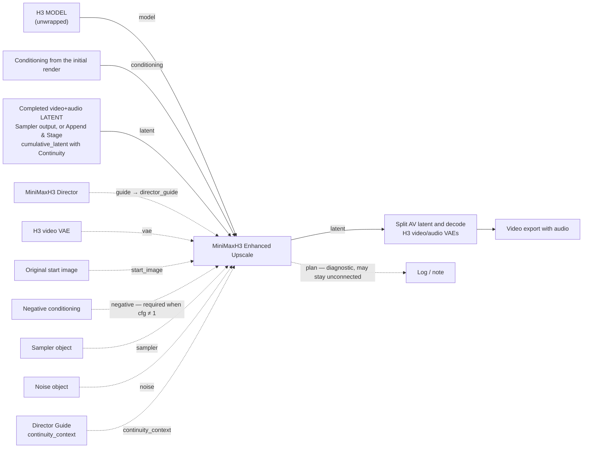
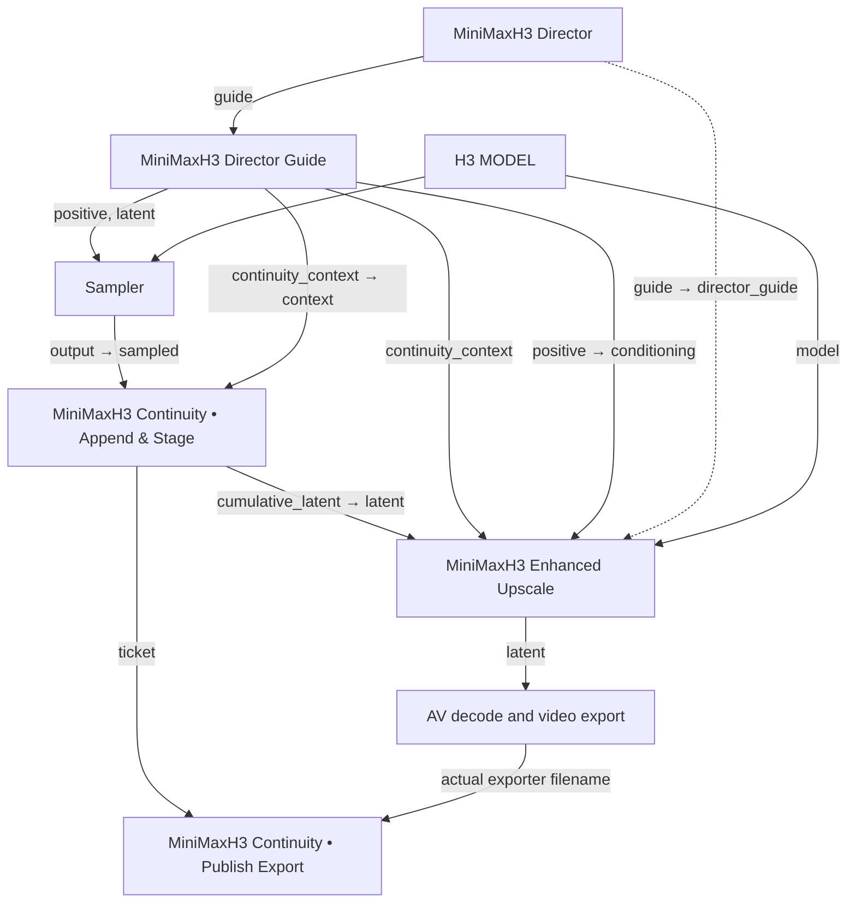

# MiniMaxH3 Enhanced Upscale

**MiniMaxH3 Enhanced Upscale** is one node for learned H3 latent upscaling and per-step spatial Tiled Diffusion. Temporal windows, overlap and tile geometry are planned internally. No parameter-helper nodes and no second Director are required.

Registered node type `DaSiWaH3TiledUpscale`, category **DaSiWa/MiniMax H3**. Saved workflows reference the node type, not the display name, so the display rename keeps every existing workflow valid.

## Wiring

Solid lines are the core path; dashed lines are optional.



Continuity take (assemble first, upscale once):



## Sockets

Required:

| Socket | Type | Widget / default |
| --- | --- | --- |
| `model` | `MODEL` | Connection. The same native, unwrapped H3 model as the initial render. |
| `conditioning` | `CONDITIONING` | Connection. The initial render's conditioning. |
| `latent` | `LATENT` | Connection. Native H3 packed video+audio latent (`[1,24,T,H/16,W/16]` video + `[1,32,2,A]` audio). |
| `scale` | FLOAT | Default **2.0**, range 1.0–8.0, step 0.1. Factor only; target = source × factor rounded to the 32-pixel grid. |
| `upscale_model` | combo | `interpolation` or a checkpoint filename from `models/latent_upscale_models/`. No automatic choice, no fallback. |
| `steps` | INT | Default **1**, range 1–100. |
| `denoise` | FLOAT | Default **0.2**, range 0–1, step 0.01. `0` skips diffusion entirely. |
| `seed` | INT | Default 0, full 64-bit range, generate-after-run supported. |

Optional:

| Socket | Type | Behavior |
| --- | --- | --- |
| `director_guide` | `MINIMAX_H3_DIRECTOR_GUIDE` | The Director's `guide` output. Endpoint images are re-encoded at target size (with `vae`). Image Inpaint uses the same short native I2V upscale/refine path. |
| `vae` | `VAE` | H3 **video** VAE. Required whenever endpoint pixels are supplied. |
| `start_image` | `IMAGE` | Full-resolution original start pixels; overrides the guide's first frame. |
| `negative` | `CONDITIONING` | Required when `cfg` ≠ 1. |
| `cfg` | FLOAT | Default **1.0**, range 0–20, step 0.1. |
| `sampler_name` | combo | Default `euler`. |
| `scheduler` | combo | Default `simple`. Sigmas are always generated internally from scheduler, steps and denoise; there is no external `sigmas` input. |
| `memory_budget_mb` | INT | Legacy/API input, hidden in the UI. Default 0 (automatic device-memory estimate), max 131072. Existing nonzero caps are preserved; not an allocator limit. |
| `sampler` | `SAMPLER` | Overrides `sampler_name` when connected. |
| `noise` | `NOISE` | Overrides the internal seed-based noise when connected. |
| `continuity_context` | `DF_H3_CONTINUITY_CONTEXT` | The Director Guide's `continuity_context`. Enables cumulative-timeline continuation handling. |
| `upscale_precision` | combo | `auto` (default), `bf16`, `fp16`, `fp32`. Learned latent-upscaler only. |
| `continuity_soft_refine` | BOOLEAN | Default **off**. Active Continuity only. |
| `continuity_mask_strength` | FLOAT | Default **1.0**, range 0–1, step 0.05. Used only with soft refine on an active continuation. |
| `spatial_tiling` | BOOLEAN | Default **on**. Spatial diffusion tiles; off uses the full target canvas. |
| `temporal_chunking` | BOOLEAN | Default **on**. Temporal windows for learned upscale and diffusion; off uses the full video. |
| `spike_guard` | BOOLEAN | Default **off**. Experimental burn-signature correction after learned upscale, before refinement. Ignored for interpolation. |
| `guard_sensitivity` | FLOAT | Default **4.3**. Lower thresholds affect more regions and increase false-positive risk. |
| `guard_strength` | FLOAT | Default **1.0**, range 0–1. Zero skips the guard without allocations or claimed repairs. |
| `guard_mode` | combo | `burn_direction` (default) or `both`. Both also detects the opposite signature and is experimental. |
| `enforce_memory_budget` | BOOLEAN | Visible as **Memory Planning**, default **on**. Off bypasses estimated diffusion-budget rejection at your own OOM risk; spatial/temporal planning, ComfyUI memory management and host RAM/spike guard checks remain active. Existing values and widget position are preserved. |
| `memory_reserve_pct` | FLOAT | **Memory Reserve (%)** slider, 0–100% in 5-point steps, default **5%**. Workspace reserve after device/model reservations. Visible only while Memory Planning is on; appended after all old widgets. |

Outputs: `latent` (`LATENT`, native packed H3 video/audio for the existing decode path) and `plan` (`STRING`, diagnostic report of the actual selected settings; it need not be connected).

## Connections

Connect the same native H3 `MODEL` and `CONDITIONING` used by the initial render. Connect the initial sampler's completed video/audio `LATENT` to `latent` (with Continuity: the Append & Stage `cumulative_latent`). The output is a native packed H3 video/audio latent for your existing decode path.

Do not connect a model already wrapped by bbaudio's Tiled Diffusion: this node installs its own wrapper on a clone only for actual spatial splits. Having the bbaudio pack installed is supported; node identifiers, helper imports and model caches are independent. This node also works without that pack installed. Model checkpoints remain separate files.

### With the Director

Optionally connect the existing Director's **guide output** directly to `director_guide`, and the existing **H3 video VAE** to `vae`. The supplied endpoint images are resized in pixel space and re-encoded at the final canvas size. Original text/reference conditioning still comes from the `conditioning` connection; no duplicated Director or widget-reading scaffolding is involved.

The Director can already have resized its images. A new VAE encode avoids stretching the old conditioning latent, but cannot recover detail removed upstream. To use full-resolution original start-image pixels, optionally connect them to `start_image`; these override the guide's first frame. Supplying endpoint images requires a matching video VAE. Endpoint re-encoding only runs when `denoise > 0` and no Continuity is active; at `denoise = 0` it is skipped, and during an active continuation the source-tail guide replaces it.

Without a Director, the node uses the incoming model, latent and conditioning. An optional `start_image` plus video VAE also works in this mode. Without endpoint pixels, existing keyframe latents are spatially resized as necessary; do not interpret this path as a verified fix for first-frame softness.

### Image Inpaint

Connect the completed initial sampler output before extracting a still. The Director's Image Inpaint mode is a native five-frame I2V pass (two video latent tokens plus its packed audio stream), not an arbitrary masked-latent inpainting API. Both interpolation and learned upscale preserve the complete short sequence; `denoise > 0` refines it using the existing native H3 sampler. Connect `director_guide` and the H3 video `vae` to re-encode the start-image anchor at target resolution during refinement. At `denoise = 0`, no endpoint encoding or diffusion is performed.

After upscale, split/decode the video latent and use **Get Image from Batch** to select the same output frame as before. The upscaler does not extract a still, change timing, or generate replacement audio. An incoming `noise_mask` remains unsupported; finish that masked pass first. Continuity remains video-only.

## Continuity

Keep the existing assembly order:

```text
Sampler → Append & Stage.cumulative_latent → MiniMaxH3 Enhanced Upscale.latent → AV decode
Director Guide.continuity_context          → MiniMaxH3 Enhanced Upscale.continuity_context
Append & Stage.ticket                     → Publish Export.ticket
Video exporter.filename                   → Publish Export.filename
```

`continuity_context` is optional. Without it, with disabled capture, or for a new take, the node performs ordinary upscale/refine. For an active continuation it expects the already assembled cumulative latent, not the unappended sampler window. Read-only source-checkpoint metadata and native timing validate the cumulative canvas and duration.

The entire video is spatially upscaled. The old prefix before the source-tail overlap is excluded from diffusion refinement, so the continuation prompt cannot regenerate earlier scenes. The already-upscaled source tail becomes native AV guide conditioning at its cumulative timeline position; sample-local keyframe positions are shifted to that same timeline. The overlapping source tail and newly appended section are refined together through the existing per-step spatial and phase-aligned temporal sampling. The final prefix is written back from the exact upscaled source, so refinement rounding cannot drift the protected region.

No overlap is appended again, no frames are added or removed, and output audio remains the original cumulative stream. Audio guide cuts use globally rounded native boundaries. Existing Director endpoint images are not re-encoded during an active continuation. Append & Stage and Publish Export retain ownership of source-resolution checkpoints and export publication; the upscaler does not write or advance them.

Existing workflow node IDs are preserved; only the visible display name changes. Tensor and native sampling tests do not establish real-model seam quality.

## Controls

- `spatial_tiling`: default **on**, controls spatial diffusion only. Off bypasses the tiled wrapper and refines the full canvas for each temporal window.
- `temporal_chunking`: default **on**, controls temporal windows in both learned latent upscale and diffusion. Off processes the full video in each pass, without temporal stitching.
- The switches independently allow automatic spatial/temporal splitting; they do not force a split. A fitting canvas uses one native full-canvas pass, and a short video can use one temporal window. Off is never silently re-enabled. Both off requests full-canvas/full-duration processing. Enabled temporal planning considers windows up to 30 latent tokens; disabled temporal planning keeps the complete video.
- `enforce_memory_budget`: default **on**, including old saved/API workflows that omit it. Off lets the preferred spatial layout and temporal-window policy run beyond the estimate, at the risk of actual OOM. It does not disable either split setting or the host RAM/spike guard checks. To attempt full-canvas/full-duration refinement despite a budget refusal, turn all three switches off.
- **Memory Reserve (%)** (`memory_reserve_pct`): slider from 0 to 100%, in 5-point steps, default 5%. It reserves workspace after device and model reservations, and is shown only with Memory Planning on. 0% removes only this additional reserve, not explicit cost checks. 100% leaves no refinement budget and gives a clear error with planning on and `denoise > 0`. Planning off ignores the reserve for plan acceptance; `denoise=0` also bypasses diffusion-budget enforcement. The aggressive 5% default is not a measured universal OOM-safe margin.
- Existing node/input/output IDs, widget slots, connected inputs and callable parameter positions are retained. The reserve input is appended after all existing controls; hidden legacy MB caps and saved Memory Planning values remain effective. The less conservative estimate can choose larger tiles or longer windows; compatibility does not imply bit-identical seeded output.

- `continuity_soft_refine`: opt-in, default **off**. Only active continuation with `continuity_context` and diffusion refinement uses it. A globally indexed smoothstep mask ramps video refine strength across the existing source-tail overlap, reaching full strength at the new section. It does not extend the overlap, touch audio, or perform RGB color matching.
- `continuity_mask_strength`: 0–1, default **1**. 0 reproduces the hard mask; 1 applies the full ramp; intermediate values mix hard and smooth masks. Start at 1 and compare against off using the same latent/seed. A minimal overlap offers fewer temporal tokens for smoothing. Without active continuation, or at `denoise = 0`, the feature has no effect. The plan report shows `soft_refine_mask=off` or the active strength. This may reduce refinement-induced light/color steps but cannot guarantee a flicker-free join.
- `scale`: defaults to 2×, derived from the actual input latent canvas, not unrelated Director widgets. Target dimensions are always source dimensions × factor, rounded to the required 32-pixel grid; there are no exact-size overrides. Neither target dimension may shrink.
- `upscale_model`: explicitly select an H3 latent-upscaler checkpoint filename or `interpolation` for bilinear spatial latent resizing without an upscaler network. There is no automatic model choice or fallback. A missing selected checkpoint raises an error instead of switching methods. Both methods are followed by diffusion refinement when `denoise > 0`.
- `steps`, `denoise`, `seed`: internal refinement controls. Defaults are 1 step and denoise 0.2. `denoise=0` skips diffusion and the endpoint re-encode, returning the upscaled latent with the original audio.
- `upscale_precision`: `auto`, `bf16`, `fp16`, or `fp32` for the learned latent-upscaler only. Auto uses ComfyUI hardware/backend policy and global precision flags (including force-fp16), with FP32 on CPU. Explicit modes cast weights and computation to the selected dtype without silently falling back; unsupported operations may fail on your backend. The incoming diffusion model and VAE are unchanged; interpolation does not use this setting. The plan reports the actual learned-upscaler dtype.
- `cfg`: defaults to 1. Values other than 1 require `negative` conditioning.
- `sampler_name` and `scheduler`: native sampler/schedule selections (defaults `euler`, `simple`). Optional connected `sampler` and `noise` objects override the internal equivalents. The native `CFGGuider` runs on a model-scoped clone with a tiled wrapper only for actual spatial splits; positive/negative conditioning and existing model patches remain active. There is no external `GUIDER` input. Sigmas are always generated internally from this node's scheduler, steps and denoise; there is no external `sigmas` input. The same sampler can be shared with the initial render without reusing its full-denoise schedule.
- `memory_budget_mb`: 0 uses free device memory plus reclaimable ComfyUI-managed weight residency on the same device (clones are counted once). A nonzero value caps that total planning pool, not the allocator. ComfyUI's configured VRAM reservation is deducted. Dynamic and normal/low-VRAM offloading reserve up to 40% of the remaining pool for weight streaming/casts instead of requiring the full checkpoint in VRAM; this 40% is a node throughput heuristic, not an aimdo residency rule. Full-resident loading budgets the complete model. Audio/text/references, full-window sampler/blending buffers and the selected workspace reserve (default 5%) also consume the budget. Other applications' VRAM is never counted as reclaimable.
- Automatic spatial planning first tries a preferred layout with at most **2.1 MP per tile**, derived from the actual input and rounded target canvas. A fitting canvas uses one tile; larger canvases use few source-shaped tiles, normally with 128px overlap. The planner searches native-phase-aligned temporal windows for that geometry. If no window fits the memory estimate, it searches smaller spatial tiles down to the existing **512×512 pixel minimum**, or the actual canvas dimension when smaller. Disabled dimensions stay fixed. There are no manual tile-size, overlap or megapixel inputs.
- Keyframe attention rows scale with each tile; native references/audio stay unsliced in the estimate. Full-target keyframe buffers, a possible previous-window anchor and pending Continuity tail guides are reserved. The plan reports preferred layout or memory fallback, actual tile/window geometry and estimated model calls. Candidate ranking is a geometric/offload proxy, not a measured runtime optimum. Larger tiles can require shorter temporal windows, so the new layout is not a universal speedup. With budget enforcement on, an insufficient estimate still fails with an actionable budget error. `denoise=0` does not require a viable diffusion budget. Estimates are not an allocator limit or OOM guarantee.

The learned H3 checkpoint selector uses ComfyUI's `latent_upscale_models` catalog and safetensors files. There are no unsafe pickle checkpoints or global GPU model caches.

## Spike Guard (experimental, default off)

The optional guard adapts the GPLv3 algorithm submitted in **Talon Upscale Node fix V4**. It compares the learned-upscaled latent, shrunk to the source grid, with the source and scores a fixed 24-channel signature reported for `minimax_h3_latent_upscaler_3d_conv_v1_bf16`. It is postprocessing, not a repair of the learned model. Other checkpoints and general quality improvements are not established.

`burn_direction` detects the submitted signed signature; `both` additionally detects its opposite. The latter has higher false-positive risk and needs real scene comparisons. Detection uses clip-wide statistics, grows connected outliers in space/time, and feathers correction into neighboring cells/latent frames. It can remove legitimate detail. Reports distinguish detected coarse cells from the actual changed output cells, give output-pixel bounding boxes with exclusive upper bounds at any scale, and name changed **latent** frames, not decoded video-frame indices. Strength zero does not claim repairs.

Output retains its incoming dtype. Statistics/residuals stay FP32 because quantizing small residuals to FP16 can change median/MAD normalization and threshold decisions. Shrinking and correction are frame-wise: no extra full-output FP32 video copy. Additional coarse-grid maps still scale with duration; RAM estimates include these and frame temporaries. Cancellation is checked within guard work. Memory refusal is explicit, without silently disabling the selected correction or unloading unrelated models.

The guard runs after learned upscale and before Continuity-tail alignment and diffusion, including at `denoise=0`. Interpolation skips it. With Continuity enabled it can also correct the old upscaled prefix; the diffusion freeze then preserves that **guard-corrected** prefix. Extending a clip can change the global statistics and earlier guard decisions. Audio remains original. Guard off preserves the existing latent path; optional inputs are appended to keep existing widget order.

## Processing and limits

Spatial tiles share one noise field and sigma schedule. Each tile uses the native H3 layout normalized to its own spatial size; visual keyframe guides are cropped to that tile, while their resolved temporal positions and reference/audio conditioning remain intact. Predictions are blended at every denoising step, rather than finishing each tile separately and stitching completed latents. This corrects the former global-coordinate refinement behavior; existing workflows retain their sockets and node ID, but seeded outputs can differ.

Temporal windows respect H3's repeating token/frame phase. Learned upscaling includes temporal convolution context; GroupNorm, residual convolutions and optional attention can still make chunked upscale differ from full-video inference. Diffusion windows overlap, with the previously sampled boundary available as conditioning. Tile/chunk choices account for source shape, target geometry, reference/text load, model weights and available device memory. Changing the attention backend or reference set can still change actual peak memory substantially.

Audio participates as frozen conditioning during refinement. The returned audio tensor is the original input stream, not a newly generated, interpolated or crossfaded soundtrack. Output timing and full latent stream lengths remain unchanged.

The node accepts native H3 batch-one packed video/audio latents, including the Director's Image Inpaint five-frame I2V pass. Fun Control/ControlNet and unfinished source denoise masks are not supported. Existing sampler/model patches are preserved except that another model-function wrapper must not already be installed.

Input, output, full noise and stitched video buffers still scale with video duration. Internal chunks bound working intermediates, not total CPU storage. A conservative RAM check rejects excessive staging allocations; no disk backing or other services are stopped. Cancellation is checked between tiles/windows. Learned upscale models are released through native ComfyUI management.

## Continuity light/color flicker: comparison hints

A small exposure or color change at the join can originate in the continuation generation, the upscale/refine pass, or temporal VAE decoding. The symptom alone does not identify the cause. This node does not perform explicit exposure/color matching across the join.

- Compare the assembled source-resolution latent decoded **before upscale** with the upscaled result from the same take. If the shift is already present before upscale, investigate the continuation sampling/prompt or VAE path rather than changing upscale parameters.
- Keep the same generated cumulative latent and seed, and compare upscale with `denoise = 0` against `denoise = 0.2`. If only refinement adds the shift, try lower denoise first. The old prefix is protected from continuation-prompt diffusion while the source tail/new section is refined; this change in treatment can reveal a subtle brightness boundary.
- A same-latent comparison of learned upscale and `interpolation`, both with `denoise = 0`, can help isolate the learned upscaler. Interpolation is a diagnostic alternative, not a promise of better detail. Learned temporal chunking is approximate; normalization and temporal context can affect light/color at window boundaries.
- Keep the H3 model, VAE, sampler settings and source treatment consistent. If using tiled/chunked VAE decode, compare a larger temporal context/overlap or a full decode only when memory permits. Do not change several stages at once.
- In the continuation prompt, ask for consistent exposure, white balance and lighting at the seam; avoid an unintended lighting transition in the next action. This is guidance, not a hard color lock.

Use a fixed seed for these comparisons. More diffusion steps or higher CFG are not an established fix. A representative output comparison is required before attributing the flicker or claiming it solved.

## Credits and reference implementations

Thanks to the upstream authors for the ideas and reference code used to develop this integration:

- [bbaudio-2025/Comfyui-MMH3-UltimateUpscale](https://github.com/bbaudio-2025/Comfyui-MMH3-UltimateUpscale): H3 upscale/refine workflow ideas and the per-step spatial tiled-diffusion/global-position reference implementation.
- [LBH-123-AI/Comfyui_Minimax_h3_latent_Upscaler](https://github.com/LBH-123-AI/Comfyui_Minimax_h3_latent_Upscaler): learned H3 latent-upscaling ideas and 3D upscaler architecture/reference code; [model repository](https://huggingface.co/LBH-123-AI/Minimax_h3_latent_Upscaler).
- [shiimizu/ComfyUI-TiledDiffusion](https://github.com/shiimizu/ComfyUI-TiledDiffusion): the tiled-diffusion foundation referenced by the bbaudio implementation.

DaSiWa's existing GPLv3 license is retained. Learned-upscaler architecture code retains its upstream MIT attribution. Credits do not replace source-code license notices. These external nodepacks are not imported at runtime; model checkpoints remain separate downloads.

A successful import, tensor test or graph validation is not a before/after visual comparison. First-frame sharpness and temporal seam quality require a representative render using your actual model, VAE, image, resolution and settings.
